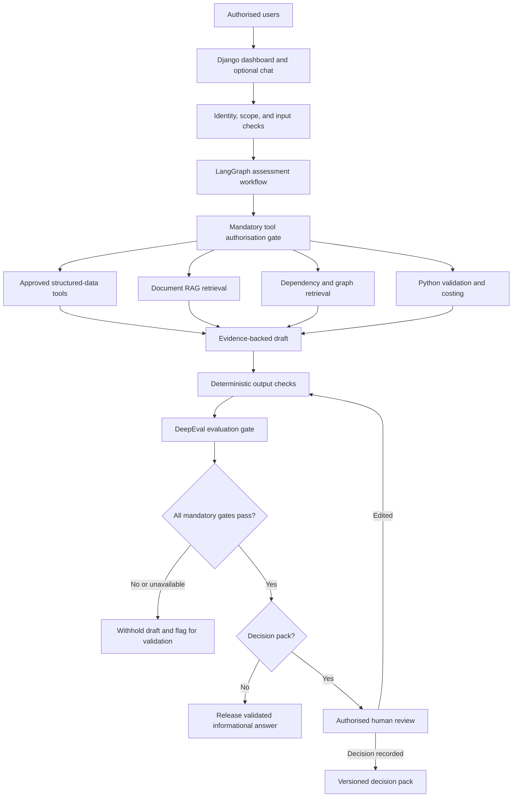

# AI Database Estate Modernisation and Licence Optimisation Advisor

**Document status:** Proposed project approach and pilot specification.

**Last updated:** 2026-11-13.

**Implementation status:** Documentation only. This document does not establish that an application, integration, guardrail, evaluation, or production control has been implemented or validated.

**Source use case:** Case 4 - AI Database Estate Modernization & License Optimization Advisor, supplied in the discussion as photographs of a presentation slide. Estate sizes and financial figures are illustrative exercise assumptions, not verified company inventory or achieved savings.

## Contents

- [Project Overview](#project-overview)
- [Source Requirements](#source-requirements)
- [Scope and Boundaries](#scope-and-boundaries)
- [User Roles and Product Features](#user-roles-and-product-features)
- [Architecture and Technology](#architecture-and-technology)
- [Data Onboarding and Evidence](#data-onboarding-and-evidence)
- [Synthetic Data Blueprint](#synthetic-data-blueprint)
- [RAG, Graph Retrieval, and Rules](#rag-graph-retrieval-and-rules)
- [LangGraph Assessment Agent](#langgraph-assessment-agent)
- [Modernisation and Cost Scenarios](#modernisation-and-cost-scenarios)
- [Guardrail Policy](#guardrail-policy)
- [DeepEval Output Evaluation](#deepeval-output-evaluation)
- [Human Review and Decision Packs](#human-review-and-decision-packs)
- [Logical Data Model](#logical-data-model)
- [Build From Scratch](#build-from-scratch)
- [Operations and Deployment](#operations-and-deployment)
- [Testing and Acceptance](#testing-and-acceptance)
- [Pilot Delivery Plan](#pilot-delivery-plan)
- [Risks and Dependencies](#risks-and-dependencies)
- [Open Decisions](#open-decisions)
- [References](#references)

## Project Overview

Build an agent-led, evidence-backed advisory application using Python and Django. Its purpose is to establish a trusted view of a database estate and support defensible modernisation and licence-optimisation decisions.

The product has three complementary parts:

- **Assessment agent:** investigates an authorised scope, selects approved analysis tools, identifies evidence gaps, compares supported options, and prepares recommendations.
- **Dashboard:** provides inventory, assessment progress, evidence, comparisons, and human-review workflows.
- **Optional chat:** lets users request assessments and ask questions about the same authorised information.

The main deliverable is actionable, traceable advice, not just a chatbot or a collection of charts. The agent is a visible, first-class feature with its own run workspace and activity history.

The central business question is: **Which databases should we retain, upgrade, consolidate, replatform, cloud-migrate, or retire, and what evidence supports each decision?**

## Source Requirements

### Business Situation

The illustrative enterprise manages approximately 1,200 database instances across Oracle, Microsoft SQL Server, PostgreSQL, and MySQL, in data centres and cloud environments. Versions, editions, options, support status, utilisation, and application dependencies are recorded inconsistently.

Licence positions are reconstructed periodically from discovery data and contracts. Modernisation proposals often assess technology, commercial exposure, and migration risk separately. The enterprise needs a defensible decision path without jeopardising performance, recoverability, or vendor compliance.

### Current Challenges and Impact

| Current challenge | Business or delivery impact |
| --- | --- |
| Inventory, editions, features, and ownership data are inconsistent. | Unknown estate scope creates licensing and modernisation risk. |
| Paid options and high-cost editions may be underused. | Avoidable run costs and audit exposure remain hidden. |
| Application dependencies and recovery requirements are incomplete. | Migration sequencing and target selection are uncertain. |
| End-of-support and technical debt are assessed separately. | Priorities do not reflect business risk and commercial timing. |
| Recommendations rely on broad assumptions. | Customers challenge savings, feasibility, and operational readiness. |

### Transformation Requirement

Provide an AI-assisted database estate advisory capability that reconciles inventory and entitlement evidence, identifies modernisation and licence-optimisation opportunities, compares options, and creates explainable decision packs. Architecture, commercial, licensing, and production decisions remain human-owned.

### Source Constraints

- CMDB, discovery tools, contracts, vendor terms, and DBA repositories remain authoritative. The application reconciles and references them; it does not silently replace their records.
- The pilot lasts 12 weeks and covers 120-180 instances across two database technologies and two business services.
- AI cannot provide a definitive legal licence position, approve architecture, or execute production migrations.
- Recommendations must preserve performance, security, HA/DR, backup, RPO/RTO, and data-residency requirements. HA/DR means high availability and disaster recovery; RPO/RTO are recovery point and recovery time objectives.
- Savings claims must separate validated facts, assumptions, one-time costs, and recurring benefits.

### Pilot Success Measures

These are targets for the proposed pilot, not guarantees or current results.

| Measure | Target | Verification approach |
| --- | --- | --- |
| Inventory reconciliation | At least 95% of pilot instances reconciled to owner, application, version, edition, and lifecycle status. | Validate the complete pilot denominator and field coverage; incomplete records do not count as fully reconciled. |
| Mapping accuracy | At least 90% accuracy for human-validated edition, feature, and dependency mappings. | Compare against a specialist-reviewed reference set using an agreed sampling and scoring method. |
| Optimisation opportunities | Identify options representing 10-15% addressable annual licence or support optimisation. | Licensing and finance reviewers validate scope, baseline, assumptions, and non-overlapping opportunities; do not report this as realised savings. |
| Migration readiness | Migration-ready recommendations for at least 80% of pilot candidates, including risk and rollback criteria. | Assess against an agreed readiness checklist; document the candidate denominator and exclusions. |
| Traceability | Trace 100% of recommendations to evidence, assumptions, confidence, human decisions, and estimated value. | Verify every recommendation has complete lineage and an explicit review status, including pending decisions. |

Before measurement begins, agree the denominators, treatment of exclusions, evidence freshness, financial baseline, and meaning of migration-ready. Do not silently exclude difficult cases to improve reported results.

### Potential AI Leverage

The source suggests estate discovery and normalisation, feature-use analysis, entitlement evidence mapping, end-of-support risk, dependency inference, workload-fit and target-pattern comparison, scenario costing, migration-wave optimisation, licence and support sensitivity analysis, and executive decision-pack generation. These are potential capabilities, not a prescription to make every task LLM-driven or autonomous.

## Scope and Boundaries

### Pilot Scope

- Import approved exports and documents, reconcile inventory, and expose data-quality issues.
- Analyse lifecycle, observed feature usage, entitlement evidence, dependencies, and operational requirements.
- Compare supported modernisation options with validated calculations and explicit assumptions.
- Provide a bounded LangGraph assessment agent, dashboard, evidence search, and optional chat.
- Apply input, retrieval, tool, state, and output controls, including DeepEval evaluation.
- Produce specialist-reviewed decision packs, assessment reports, and an audit trail.

Start with uploaded CSV/Excel exports and approved documents. Introduce live read-only connectors only after source owners approve the access, query designs, and operating limits.

### Explicit Exclusions

- No production database changes, migrations, restarts, tuning changes, patching, or licence purchases.
- No autonomous architecture approval or definitive legal licensing certification.
- No arbitrary SQL execution, general-purpose shell tools, or unrestricted network access for the agent.
- No default access to application business rows, secrets, or all enterprise documents.
- No automatic updates to authoritative source systems as a consequence of reconciliation.
- No claimed savings, compatibility, or operational readiness without supporting evidence and review.

The application may write assessment records, evidence metadata, reviews, and audit events to its own application database under controlled permissions. This is separate from changing the production databases being assessed.

## User Roles and Product Features

### Roles

| Role | Main responsibilities |
| --- | --- |
| DBA or estate analyst | Curate inventory, validate observed usage and dependencies, run assessments, and review technical findings. |
| Application or business-service owner | Confirm ownership, criticality, dependencies, service windows, and recovery requirements. |
| Licensing or commercial specialist | Interpret entitlement evidence and vendor terms; validate licensing findings and commercial assumptions. |
| Architect or migration specialist | Validate target patterns, operational constraints, readiness, sequencing, and rollback criteria. |
| Manager or report viewer | Review authorised summaries, opportunities, risk, progress, and decision outcomes. |
| Platform administrator | Operate application configuration and access controls; administrative access is not automatically business approval authority. |

Use the organisation's approved identity provider and role-based permissions. Exact role assignments and segregation-of-duties rules remain to be confirmed.

### Feature Catalogue

| Feature | User-facing behaviour |
| --- | --- |
| AI Assessment Agent | Accept an objective and authorised database scope, create a bounded assessment plan, choose approved tools, investigate findings, and prepare evidence-backed recommendations. |
| Agent Run Centre | Show the plan, current step, tool activity, collected evidence, outstanding questions, evaluation status, and review status. Support pause, resume, and cancellation. |
| Data onboarding | Upload approved exports and documents; inspect validation errors, mapping conflicts, duplicates, freshness, and import history. |
| Estate dashboard | Display inventory coverage, technologies, versions, editions, ownership, lifecycle exposure, potential opportunities, and assessment progress. Keep unknown values visible. |
| Inventory workspace | Search, filter, and inspect databases by service, application, owner, technology, environment, edition, lifecycle status, and evidence quality. |
| Database assessment | Inspect evidence, usage, features, entitlements, dependencies, recovery needs, findings, and missing information for one instance. |
| Licence optimisation | Identify potential underused editions/options and entitlement-review gaps using approved rules and contractual evidence. |
| Modernisation scenarios | Compare retain, upgrade, consolidate, replatform, cloud-migrate, and retire options, including cost, risk, prerequisites, and operational constraints. |
| Dependency and impact analysis | Explore service/application/database/infrastructure relationships and their effect on migration sequencing, consolidation, retirement, and recovery. |
| Evidence search and optional chat | Ask scoped questions and receive answers grounded in authorised records, passages, and relationship evidence. |
| Guardrail and evaluation status | Explain whether an assessment is validated, blocked, incomplete, or awaiting review without exposing sensitive internals. |
| Human review and reporting | Validate, amend, approve, or reject recommendations and generate versioned decision packs and authorised summary reports. |

### Example User Journey

1. An analyst uploads inventory, usage, entitlement, and dependency exports for the selected pilot scope.
2. The application flags conflicting instance identities, missing owners, and incomplete recovery evidence.
3. The analyst starts an assessment such as: "Assess these selected databases for licence optimisation."
4. The agent investigates through approved tools and requests clarification where evidence is insufficient.
5. The analyst watches progress in the Agent Run Centre and inspects source-linked findings.
6. Validated drafts are routed to the appropriate technical and commercial reviewers.
7. Reviewers record decisions; authorised users obtain the decision pack and portfolio summary.

The dashboard is the primary workspace. Chat is a conversational interface to the same governed capabilities, not a separate source of truth or a way to bypass controls.

## Architecture and Technology

### Proposed Stack

| Component | Responsibility |
| --- | --- |
| Python and Django | Application logic, interface, authentication integration, authorisation, administration, data records, and review workflows. |
| Django templates and Bootstrap | Initial server-rendered, work-focused user interface; a separate React application is not required for the proposed pilot. |
| LangGraph | Explicit execution states, bounded investigation, controlled branching, durable checkpoints, clarification, and human-review interrupts. |
| LangChain integrations | Model, retriever, and tool adapters where useful; LangGraph owns the assessment workflow. |
| PostgreSQL | Structured inventory, source metadata, dependencies, assessments, scenarios, decisions, and audit records. |
| pgvector | Embedding-based retrieval of approved document passages alongside their access and provenance metadata. |
| PostgreSQL dependency tables | Initial relationship store for graph-assisted retrieval; a dedicated graph database is conditional on demonstrated need. |
| Celery and Redis | Background ingestion, processing, assessment, and evaluation work with bounded retries and cancellation checks. |
| Approved model endpoints | Generation, embeddings, and evaluation within approved hosting, retention, and data-processing boundaries. |
| DeepEval | Answer-quality and advisory-policy evaluation, with separate runtime and offline testing configurations. |
| Approved document storage | Access-controlled storage for source files and versioned generated reports; the hosting option remains open. |

Library versions, provider deployments, infrastructure sizing, and hosting have not been selected or installed as part of this document.

### Logical Architecture



Input, retrieval, tool, and output failures stop or pause the run; their successful execution is mandatory and cannot be bypassed through model-generated routing. There is deliberately no production-execution branch.

Keep one modular application and one controlled assessment agent for the pilot. Separate autonomous agents or additional services are not a default requirement.

## Data Onboarding and Evidence

### Expected Inputs

| Input | Useful information |
| --- | --- |
| CMDB and discovery exports | Instance identities, hosts, environments, owners, applications, technologies, versions, and editions. |
| Usage and feature observations | Observation periods, utilisation, consumed options, and measured workloads. Missing observations do not prove non-use. |
| Entitlement and commercial records | Entitlements, covered entities, metrics, contract periods, support charges, and applicable terms. |
| Dependency records | Application/service mappings, hosting, cluster membership, replication, and approved connectivity or dependency observations. |
| DBA and architecture repositories | Lifecycle assessments, operational constraints, approved target patterns, configuration evidence, and recovery requirements. |
| Vendor and policy documents | Support timelines, applicable terms, licensing interpretation references, security policies, and platform standards. |

Direct production access is not needed to start the pilot. Prefer approved exports and metadata over collecting sensitive business data.

### Processing Requirements

1. Validate file type, size, structure, required fields, source ownership, and processing permission before ingestion.
2. Preserve the source version and observation time; maintain a link from each accepted fact to its source.
3. Normalise identities using stable source IDs and reviewed matching rules. Do not merge instances solely because names are similar.
4. Validate values and relationships; route ambiguous ownership, editions, entitlements, and inferred links for review.
5. Record freshness, gaps, conflicting sources, and the authority applicable to each fact type.
6. Publish only validated or explicitly provisional records to the appropriate assessment scope.

Retain imported source values alongside reconciled values. A corrected application view must not erase the original evidence or silently update a CMDB or contract record.

### Evidence Metadata

Evidence should carry an identifier, source system/document, version, source owner, collection or observation date, applicable period, entity scope, access classification, review status, and a record or passage locator. Record known limitations and the basis of any confidence or evidence-quality label.

Use explicit states such as observed, human-validated, inferred, conflicting, stale, and missing. Model-generated confidence is not a calibrated probability of correctness.

## Synthetic Data Blueprint

### Purpose and Status

Create an entirely fictional estate that reproduces the business problem before any real infrastructure access is considered. It must contain normal records, genuine optimisation candidates, operational blockers, inconsistent source records, incomplete observations, contractual evidence, graph relationships, and security/evaluation test cases.

This section specifies future data-generation work. No generator, CSV, document collection, database, or application is created by this README update. The profiles below are proposed reproducible fixtures, not a change to the actual pilot scope or a claim that the business targets will be met.

Do not use production exports, real identities, actual credentials, copied contracts, or live infrastructure addresses to make synthetic data appear realistic. Use fictional names, reserved `.invalid` host/email domains, and visibly synthetic identifiers. All financial amounts, licensing rules, feature restrictions, support dates, and entitlement documents in the fixture are invented test assumptions, not vendor guidance.

### Reproducible Profiles

| Parameter | Default synthetic pilot | Optional scale profile |
| --- | --- | --- |
| Profile identifier | `pilot` | `full` |
| Database instances, N | 150 | 1,200 |
| Technologies, T | 2: Microsoft SQL Server and Oracle, 75 instances each | 4: SQL Server, Oracle, PostgreSQL, and MySQL, 300 instances each |
| Fictional business services, S | 2: Order Processing and Financial Reporting | The same 2 services |
| Applications, A | 10, with 5 per service | 40, with 20 per service |
| Servers, H | 30, with 5 instances per server | 240, with 5 instances per server |
| Owners | 12: 2 service owners and 10 application owners | 42: 2 service owners and 40 application owners |
| Daily observation window, D | 90 days | 90 days |
| Frozen as-of date | `2026-11-13` | `2026-11-13` |
| Observation dates | `2026-08-16` through `2026-11-13`, inclusive | The same dates |
| Pseudorandom seed | `20261113` | `20261113` |
| Dataset version | `synthetic-db-estate-v1-pilot` | `synthetic-db-estate-v1-full` |
| Currency | GBP only | GBP only |

Use the 150-instance profile for the initial end-to-end demonstration. The 1,200-instance profile is a separate scale test outside the 120-180-instance pilot; do not combine its results with pilot acceptance figures.

Assign 75 databases to each service in the pilot and 600 to each service at scale. Keep technology totals balanced while allocating servers and applications. A primary application owns 15 database associations in the pilot and 30 at scale; extra shared dependencies are additional graph edges, not additional databases. Servers have a single technology affinity for this fixture. HA/DR pairs must use different servers.

### Future Output Layout

The following paths describe planned generated artifacts, not existing files. Each profile is written to a new versioned directory.

```text
synthetic_data/<dataset_version>/
    manifest.json
    raw/
        <the source CSV and JSONL files listed below>
        documents/
            DOC001.md ...
    ground_truth/
        oracle_manifest.json
        database_truth.csv
        identity_map.csv
        dependency_truth.csv
        problem_labels.csv
        expected_results.jsonl
        qa_goldens.jsonl
        guardrail_cases.jsonl
```

Only explicitly allowlisted files under `raw/` are available to the importer and application. The evaluator-only `ground_truth/` directory must not be web-served, indexed, embedded, mounted into the application/agent worker, or supplied to the answering model. Keep this README and other project specifications out of the retrieval corpus because they describe expected outcomes.

Use a separate evaluator identity or mount for ground truth when demonstrating isolation. A developer-side path exclusion alone is not operating-system access control. Runtime DeepEval receives authorised request evidence; only the offline test evaluator receives labelled expected answers.

### Shared Columns and Formats

Every tabular CSV and JSONL record in the file-count table has these **6 shared columns/fields** in addition to its file-specific schema. The table's column counts include all 6. Document bodies and manifest JSON objects use their own formats and are not tabular records.

| Shared field | Type | Meaning |
| --- | --- | --- |
| `dataset_version` | text | Version/profile identifier; prevents mixing different generated datasets. |
| `is_synthetic` | boolean | Always `true`; retained through import and reporting. |
| `source_system` | text | Fictional source such as `SIM_CMDB`, `SIM_DISCOVERY`, `SIM_DBA`, or `SIM_FINANCE`. |
| `source_record_id` | text | Unique file-qualified record locator for lineage; different from an entity's business key. |
| `observed_at` | UTC timestamp | Frozen source observation time, never an uncontrolled current timestamp. |
| `scope_service_id` | nullable text | Service scope where applicable; shared records require explicit access rules, not automatic unrestricted access. |

Use UTF-8 CSV with a header row, standard CSV quoting, stable field ordering, and LF line endings. Row counts exclude the header. JSONL has one object per line. Use ISO dates, UTC timestamps, lowercase booleans, decimal numbers rounded with decimal arithmetic, and structured JSON arrays/objects rather than comma-separated lists inside fields. Empty CSV fields and JSON `null` represent missing values; zero represents an observed zero, not missing data.

In the schemas below, `?` means nullable; fields are otherwise required in the clean baseline. `PK` is a primary key and `FK` is a foreign key. Deliberate source-quality faults can create additional raw nulls or conflicts only where recorded in the hidden fault labels. Resolved application records must retain their provisional state until validation succeeds.

### Files, Rows, Columns, and Grain

Counts are exact for the proposed v1 profiles. Common metadata is included in the column counts. Do not generate extra unlabeled rows to make dashboards look fuller.

| File relative to profile directory | Pilot rows | Full rows | Columns | Record grain |
| --- | --- | --- | --- | --- |
| `raw/owners.csv` | 12 | 42 | 12 | One fictional owner |
| `raw/business_services.csv` | 2 | 2 | 12 | One business service |
| `raw/applications.csv` | 10 | 40 | 13 | One application |
| `raw/servers.csv` | 30 | 240 | 18 | One server |
| `raw/discovery_inventory.csv` | 150 | 1200 | 17 | One discovery record per database |
| `raw/cmdb_inventory.csv` | 160 | 1280 | 17 | One CMDB source record, including deliberate duplicates |
| `raw/dba_registry.csv` | 150 | 1200 | 16 | One DBA record per database |
| `raw/usage_daily.csv` | 13500 | 108000 | 18 | One database per day, including explicit failed-collection rows |
| `raw/feature_catalog.csv` | 12 | 24 | 14 | Six synthetic features per technology |
| `raw/feature_usage.csv` | 900 | 7200 | 15 | One database per applicable synthetic feature over the 90-day window |
| `raw/lifecycle_catalog.csv` | 4 | 8 | 13 | Two fictional versions per technology |
| `raw/operational_requirements.csv` | 150 | 1200 | 18 | One requirements record per database |
| `raw/contracts.csv` | 4 | 8 | 15 | Two fictional contracts per technology |
| `raw/entitlements.csv` | 12 | 24 | 15 | Three synthetic entitlement entries per contract |
| `raw/entitlement_allocations.csv` | 180 | 1440 | 13 | N base allocations plus N/5 additional allocations |
| `raw/cost_baselines.csv` | 150 | 1200 | 14 | One fictional finance allocation per database |
| `raw/scenario_prices.csv` | 24 | 48 | 19 | Technology x two source demo tiers x six actions |
| `raw/dependencies.csv` | 325 | 2560 | 17 | Available source relationship evidence after deliberate omissions |
| `raw/documents.csv` | 24 | 48 | 16 | Twelve fictional evidence documents per technology |
| `raw/document_chunks.jsonl` | 96 | 192 | 13 | Four deterministic sections per evidence document |
| `raw/access_principals.csv` | 8 | 8 | 12 | One fictional application/test principal |
| `raw/access_grants.csv` | 12 | 12 | 13 | One explicit scope/capability grant |
| `ground_truth/database_truth.csv` | 150 | 1200 | 18 | One clean canonical database; evaluator only |
| `ground_truth/identity_map.csv` | 460 | 3680 | 11 | One mapping for each discovery, CMDB, and DBA source record |
| `ground_truth/dependency_truth.csv` | 335 | 2640 | 17 | Complete clean relationship set; evaluator only |
| `ground_truth/problem_labels.csv` | 150 | 1200 | 11 | One database with its base cohort and fault overlays |
| `ground_truth/expected_results.jsonl` | 150 | 1200 | 14 | One expected assessment contract per database |
| `ground_truth/qa_goldens.jsonl` | 60 | 120 | 15 | One labelled question and authorised reference result |
| `ground_truth/guardrail_cases.jsonl` | 40 | 40 | 16 | One isolated adversarial or failure-injection test |

The `raw/documents/` directory contains 24 Markdown bodies in the pilot and 48 at scale, matching `raw/documents.csv`. The normal baseline has no additional attack documents. Chunk count is fixed by four indexed body sections per document, not a guessed tokenizer output. Embeddings are derived later and do not change source row counts.

`manifest.json` records profile parameters, schema/generator versions, filenames, actual row counts, column order, hashes, date range, and dependency versions. The private oracle manifest records expected-label versions and private hashes. Neither manifest should publish per-instance answer labels to the application.

### Complete File-Specific Schemas

Append these fields to the 6 shared fields. `source_record_id` is the record's lineage locator; keys such as `discovery_record_id` are joinable source identifiers. Nullable values remain explicitly unknown.

#### owners.csv

Schema (6 file-specific fields): `owner_id:text (PK)`, `display_name:text`, `team_name:text`, `owner_role:enum`, `contact_ref:text`, `active:boolean`.

Use fictional contacts such as `owner001@example.invalid`. Source owners and access principals are separate concepts; an owner's presence in inventory does not grant application access.

#### business_services.csv

Schema (6 file-specific fields): `service_id:text (PK)`, `service_name:text`, `service_owner_id:text (FK)`, `criticality:enum`, `residency_policy:text`, `description:text`.

#### applications.csv

Schema (7 file-specific fields): `application_id:text (PK)`, `service_id:text (FK)`, `application_name:text`, `application_owner_id:text (FK)`, `criticality:enum`, `environment:enum`, `maintenance_window:text`.

#### servers.csv

Schema (12 file-specific fields): `server_id:text (PK)`, `hostname:text`, `service_id:text (FK)`, `environment:enum`, `hosting_model:enum`, `region:text`, `vcpu:integer`, `ram_gb:integer`, `virtualisation_group:text?`, `technology_affinity:enum`, `os_family:enum`, `patch_group:text`.

#### discovery_inventory.csv

Schema (11 file-specific fields): `discovery_record_id:text (PK)`, `asset_ref:text?`, `instance_name:text`, `server_id:text (FK)`, `technology:enum`, `version_id:text (FK)`, `edition:enum`, `environment:enum`, `discovered_owner_id:text? (FK)`, `discovered_application_id:text? (FK)`, `last_seen_at:timestamp`.

#### cmdb_inventory.csv

Schema (11 file-specific fields): `cmdb_record_id:text (PK)`, `asset_ref:text?`, `instance_name:text`, `server_id:text (FK)`, `technology:enum`, `version:text`, `edition:enum`, `owner_id:text? (FK)`, `application_id:text? (FK)`, `environment:enum`, `record_updated_at:timestamp`.

#### dba_registry.csv

Schema (10 file-specific fields): `dba_record_id:text (PK)`, `asset_ref:text?`, `server_id:text (FK)`, `instance_name:text`, `owner_id:text? (FK)`, `application_id:text? (FK)`, `validated_version_id:text? (FK)`, `validated_edition:enum?`, `dependency_review_status:enum`, `remarks:text`.

#### usage_daily.csv

Schema (12 file-specific fields): `observation_id:text (PK)`, `discovery_record_id:text (FK)`, `sample_date:date`, `collection_status:enum`, `cpu_avg_pct:decimal?`, `cpu_p95_pct:decimal?`, `memory_p95_pct:decimal?`, `storage_used_gb:decimal?`, `connections_peak:integer?`, `read_iops_p95:integer?`, `write_iops_p95:integer?`, `observation_hours:decimal`.

Enforce uniqueness of `(discovery_record_id, sample_date)`. For missing collection, use null metrics and zero observation hours. A successful observed idle sample can contain zero metrics with positive observation hours.

#### feature_catalog.csv

Schema (8 file-specific fields): `feature_id:text (PK)`, `technology:enum`, `feature_name:text`, `minimum_demo_tier:enum`, `separate_entitlement_required:boolean`, `critical_for_ha:boolean`, `demo_rule_id:text`, `document_id:text (FK)`.

Use six visibly synthetic identifiers per technology, such as `SIM_SQL_FEATURE_01`. For proprietary-technology demonstrations, include basic features, premium-tier features, and a separately entitled test option. For PostgreSQL/MySQL scale rows, do not invent proprietary licence charges or actual paid-feature restrictions: use zero base licence cost and explicitly fictional support/service-tier scenarios.

#### feature_usage.csv

Schema (9 file-specific fields): `feature_observation_id:text (PK)`, `discovery_record_id:text (FK)`, `feature_id:text (FK)`, `window_start:date`, `window_end:date`, `usage_count:integer?`, `coverage_pct:decimal`, `collection_status:enum`, `last_used_at:timestamp?`.

Enforce uniqueness of `(discovery_record_id, feature_id, window_start, window_end)` and technology compatibility. Null usage is unknown, not zero use. Generate six rows per database even when one observation is unavailable.

#### lifecycle_catalog.csv

Schema (7 file-specific fields): `version_id:text (PK)`, `technology:enum`, `display_name:text`, `release_date:date`, `support_end_date:date`, `lifecycle_state:enum`, `document_id:text (FK)`.

Use fictional versions such as `SIM_SQL_LEGACY` and `SIM_SQL_CURRENT`, with an explicitly simulated past support end and future support end. Do not present invented dates as the real lifecycle of a vendor release. Derive lifecycle state from the frozen as-of date.

#### operational_requirements.csv

Schema (12 file-specific fields): `requirement_id:text (PK)`, `dba_record_id:text (FK)`, `service_id:text (FK)`, `business_criticality:enum`, `ha_required:boolean?`, `rpo_minutes:integer?`, `rto_minutes:integer?`, `backup_retention_days:integer?`, `required_residency:enum?`, `minimum_memory_gb:integer?`, `max_latency_ms:decimal?`, `owner_confirmed:boolean`.

#### contracts.csv

Schema (9 file-specific fields): `contract_id:text (PK)`, `technology:enum`, `provider_name:text`, `contract_start:date`, `contract_end:date`, `currency:enum`, `terms_document_id:text (FK)`, `renewal_notice_days:integer`, `review_status:enum`.

#### entitlements.csv

Schema (9 file-specific fields): `entitlement_id:text (PK)`, `contract_id:text (FK)`, `demo_product_code:text`, `metric:enum`, `units_purchased:decimal`, `support_tier:enum`, `effective_from:date`, `effective_to:date`, `terms_document_id:text (FK)`.

Use an invented metric such as `SIM_INSTANCE_UNIT` only for test licensing rules. It is not a substitute for real processor/core, virtualisation, mobility, or contractual rules. PostgreSQL/MySQL rows can represent fictional support subscriptions rather than purchased database licence rights.

#### entitlement_allocations.csv

Schema (7 file-specific fields): `allocation_id:text (PK)`, `entitlement_id:text (FK)`, `discovery_record_id:text (FK)`, `allocated_units:decimal`, `assignment_start:date`, `assignment_end:date?`, `allocation_status:enum`.

Create one base licence/support allocation per database plus one extra support/option allocation for N/5 databases. Validate ordinary allocations against available units; deliberately insufficient entitlement cases must be labelled and remain advisory findings.

#### cost_baselines.csv

Schema (8 file-specific fields): `cost_record_id:text (PK)`, `discovery_record_id:text (FK)`, `annual_licence_gbp:decimal`, `annual_support_gbp:decimal`, `annual_hosting_gbp:decimal`, `annual_operations_gbp:decimal`, `finance_review_status:enum`, `baseline_as_of:date`.

These are fictional finance allocations. Use this file as the per-instance recurring-cost baseline; do not add full contract totals again and double-count the same spending. Base licence cost is zero for PostgreSQL/MySQL fixtures.

#### scenario_prices.csv

Schema (13 file-specific fields): `price_id:text (PK)`, `technology:enum`, `source_demo_tier:enum`, `action:enum`, `target_pattern:text`, `target_demo_tier:enum`, `annual_licence_gbp:decimal?`, `annual_support_gbp:decimal?`, `annual_hosting_gbp:decimal?`, `annual_operations_gbp:decimal?`, `one_time_cost_gbp:decimal?`, `price_review_status:enum`, `target_version_id:text? (FK)`.

The key is `(technology, source_demo_tier, action)`. Two source tiers and six actions produce 12 rows per technology. Actions are retain, upgrade, consolidate, replatform, cloud_migrate, and retire. A retain-platform variant may optimise a demo edition; always show the unchanged baseline separately. A price row does not establish technical eligibility. Missing prices remain unknown, and retirement costs are not assumed to be zero.

#### dependencies.csv

Schema (11 file-specific fields): `edge_id:text (PK)`, `from_entity_type:enum`, `from_entity_id:text`, `to_entity_type:enum`, `to_entity_id:text`, `relationship_type:enum`, `evidence_document_id:text? (FK)`, `evidence_source_record_id:text?`, `confidence_basis:enum`, `validation_status:enum`, `edge_status:enum`.

Entity endpoints use a validated typed registry. Each edge needs at least one resolvable evidence locator. Use explicit active, inactive, or unknown states. An ownership association is not automatically an observed runtime dependency.

#### documents.csv

Schema (10 file-specific fields): `document_id:text (PK)`, `document_type:enum`, `technology:enum`, `relative_path:text`, `document_version:text`, `effective_from:date`, `effective_to:date?`, `authority_status:enum`, `allowed_service_ids:json`, `content_sha256:text`.

Create 12 original fictional documents per technology: 2 contracts, 2 lifecycle references, 4 feature-policy references, 2 architecture-pattern references, 1 recovery/residency policy, and 1 DBA review guide. Mark every body and indexed section `SYNTHETIC TEST EVIDENCE - NOT VENDOR TERMS`. Use four indexed body sections per document: scope, test rules/facts, limitations, and review requirements.

The pilot has 20 shared documents and 2 restricted to each service; the full profile has 40 shared and 4 restricted to each service. Shared means an explicit permitted-service list, not anonymous access. Do not include per-instance oracle labels or prewritten agent answers in these documents.

#### document_chunks.jsonl

Schema (7 file-specific fields): `chunk_id:text (PK)`, `document_id:text (FK)`, `section_number:integer`, `section_title:text`, `passage_locator:text`, `text:text`, `document_sha256:text`.

Assign section numbers 1-4 and deterministic chunk IDs. Inherit the document ACL at retrieval time and validate its hash/version. Never let a vector match bypass document permissions.

#### access_principals.csv

Schema (6 file-specific fields): `principal_id:text (PK)`, `display_name:text`, `role:enum`, `tenant_id:text`, `subject_ref:text`, `active:boolean`.

Use eight fictional principals: one analyst and one DBA per service, one shared licensing reviewer, one shared architect, one shared manager, and one platform administrator. These are test identity fixtures, not production credentials or passwords.

#### access_grants.csv

Schema (7 file-specific fields): `grant_id:text (PK)`, `principal_id:text (FK)`, `scope_type:enum`, `scope_id:text`, `permissions:json`, `expires_at:timestamp?`, `granted_by:text`.

Give each analyst/DBA one service grant (4 rows), each shared reviewer/manager one grant per service (6 rows), and the platform administrator two platform-operations grants (2 rows). The administrator does not receive estate-data access by default. Import grants only through a trusted test-administration path; ordinary uploads cannot confer access.

#### database_truth.csv

Schema (12 file-specific fields): `instance_id:text (PK)`, `asset_ref:text`, `server_id:text (FK)`, `application_id:text (FK)`, `owner_id:text (FK)`, `technology:enum`, `version_id:text (FK)`, `edition:enum`, `environment:enum`, `scenario_cohort:enum`, `expected_evidence_state:enum`, `expected_action_group:enum`.

Evaluator only. Use stable IDs such as `DB0001`, `APP001`, `HOST001`, and `SVC01`. Raw discovery/CMDB/DBA exports use their own record IDs and may expose a shared asset reference; do not simply import this clean table to skip reconciliation.

#### identity_map.csv

Schema (5 file-specific fields): `identity_map_id:text (PK)`, `source_file:text`, `input_source_record_id:text`, `instance_id:text (FK)`, `match_basis:enum`.

Evaluator only. Map all 150 discovery, 160 CMDB, and 150 DBA records in the pilot, including duplicate CMDB rows, giving 460 mappings. At scale, 1200 + 1280 + 1200 gives 3680 mappings. Duplicate source records must not create additional canonical instances.

#### dependency_truth.csv

Schema (11 file-specific fields): `edge_id:text (PK)`, `from_entity_type:enum`, `from_entity_id:text`, `to_entity_type:enum`, `to_entity_id:text`, `relationship_type:enum`, `evidence_document_id:text? (FK)`, `evidence_source_record_id:text?`, `confidence_basis:enum`, `validation_status:enum`, `edge_status:enum`.

Evaluator only. Use the same schema as available dependencies, but retain the clean relationship set before deliberate omissions.

#### problem_labels.csv

Schema (5 file-specific fields): `label_id:text (PK)`, `instance_id:text (FK)`, `base_cohort:enum`, `fault_codes:json`, `expected_behaviour:json`.

Evaluator only. One row per database can hold several fault overlays; do not multiply the database denominator by the number of faults.

#### expected_results.jsonl

Schema (8 file-specific fields): `case_id:text (PK)`, `instance_id:text (FK)`, `expected_status:enum`, `allowed_actions:json`, `prohibited_claims:json`, `expected_calculations:json`, `required_evidence_ids:json`, `blocking_gaps:json`.

Expected answers must reflect what the authorised agent can actually establish from available source evidence, not everything the generator knows privately. Where true facts were withheld, abstention can be the correct result. Do not require the agent to guess an oracle value.

#### qa_goldens.jsonl

Schema (9 file-specific fields): `case_id:text (PK)`, `split:enum`, `principal_id:text (FK)`, `input:text`, `expected_output:text`, `expected_tools:json`, `expected_evidence_ids:json`, `expected_scope:json`, `case_category:enum`.

Use five categories: inventory, document evidence, dependency impact, cost comparison, and missing-evidence handling. The pilot has 12 cases per category and 20 cases per development/calibration/holdout split; scale has 24 per category and 40 per split. Keep paraphrases of the same test family in one split. Protect the holdout from prompt and threshold tuning.

#### guardrail_cases.jsonl

Schema (10 file-specific fields): `case_id:text (PK)`, `split:enum`, `attack_surface:enum`, `input:text`, `payload_document_id:text?`, `principal_id:text (FK)`, `simulated_fault:enum?`, `expected_gate:enum`, `expected_status:enum`, `forbidden_effects:json`.

Use 40 isolated cases covering direct injection, indirect document/tool-result injection, cross-service access, prohibited tool requests, fictional secret-canary disclosure, evaluator outage, stale approval, and unauthorised resume. Allocate 10 development, 10 calibration, and 20 holdout cases. Inject payloads into a controlled test copy or in-memory response; do not poison the normal document corpus or change baseline file counts. Use nonfunctional canaries, never real secrets.

### Relationships and Count Formulas

- Services reference owners; applications reference a service and owner; servers reference a service.
- Discovery, CMDB, and DBA records join through reviewed asset references or identity matching. Daily usage, feature usage, allocations, and cost baselines reference discovery records; operational requirements reference DBA records.
- Contracts reference evidence documents; entitlements reference contracts; allocations reference entitlements and discovery records. Feature/lifecycle catalogues reference their synthetic policy documents.
- Chunks reference documents. Access grants reference principals and service/platform scopes. Graph endpoints must resolve to allowed entity types and records.
- The clean graph contains N `HOSTED_ON` edges, N primary application `DEPENDS_ON` edges, A application `PART_OF` service edges, N/10 cross-server `REPLICATES_TO` edges, and N/15 additional shared application `DEPENDS_ON` edges.
- Clean graph count is `2*N + A + N/10 + N/15`: 335 pilot or 2640 full. Omit N/15 selected primary dependency edges from the available source graph: 325 pilot or 2560 full. Include cross-service examples among the shared edges and enforce visibility on both endpoints.
- Daily observations equal `N*90`: 13500 or 108000. Feature observations equal `N*6`: 900 or 7200. Documents equal `T*12`, chunks equal `T*48`, and scenario-price rows equal `T*2*6`.
- Identity-map rows equal discovery + CMDB + DBA source rows: 460 or 3680. Canonical inventory is always N; duplicates and aliases do not change it.

Do not require the whole graph to be acyclic; legitimate dependency cycles can exist. Validate endpoint types, direction, edge state, duplicate-edge handling, and traversal limits instead.

### Business-Problem Cohorts

Assign each database exactly one base cohort. These counts sum to N. Then apply separately labelled source-quality overlays, which may overlap without creating new instances.

| Base cohort | Pilot instances | Full instances | Intended assessment behaviour |
| --- | --- | --- | --- |
| Potential premium-tier optimisation | 20 | 160 | Consider a lower demo tier only with adequate feature coverage, compatible requirements, and validated terms. |
| Consolidation candidates | 15 | 120 | Compare capacity, dependencies, shared-failure impact, and recovery requirements before recommending. |
| Potential retirement | 10 | 80 | Observed non-use, inactive incoming dependencies, and owner evidence support review; never execute retirement. |
| Simulated end-of-support | 25 | 200 | Recommend an upgrade assessment with compatibility, risk, and rollback prerequisites. |
| Critical premium-feature or HA requirement | 20 | 160 | Reject a cheaper tier when it would remove required capabilities or violate recovery constraints. |
| Residency/recovery-constrained target | 20 | 160 | Block an incompatible cloud/target pattern and explain the unmet requirement. |
| Incomplete evidence | 10 | 80 | Request clarification or return Needs validation rather than inventing missing facts. |
| Healthy unchanged-baseline controls | 30 | 240 | Permit retain/no-change advice and avoid manufacturing savings or risks. |

At scale, licensing-specific positive cases apply only where the synthetic technology policy supports them; PostgreSQL/MySQL examples use support/platform optimisation rather than fictional proprietary licence savings. A cohort is a test intention, not a guaranteed recommendation: the final expected result must be recalculated after evidence gaps and access restrictions are applied.

### Deliberate Data-Quality Overlays

| Overlay | Pilot count | Full count | How to create it and what should happen |
| --- | --- | --- | --- |
| Duplicate CMDB rows | 10 extra rows | 80 extra rows | Copy selected logical records with new source IDs; reconciliation must not create extra databases. |
| Missing owner in CMDB | 12 instances | 96 instances | Blank owner fields; half are recoverable from authorised DBA/discovery evidence and half are unavailable across all instance-owner sources. |
| Owner unavailable everywhere | 6 instances, included above | 48 instances, included above | Retain private truth but withhold source proof; report unknown ownership instead of assuming application ownership proves instance ownership. |
| Edition conflict | 15 instances | 120 instances | Alter the CMDB edition while preserving labelled review evidence; surface the conflict and resolve only with the applicable authority. |
| Version conflict | 10 instances | 80 instances | Make a CMDB version stale; use dated discovery/DBA evidence and source precedence rather than majority voting. |
| Alias or case variation | 20 instances | 160 instances | Change display names/case, remove selected non-discovery asset references, and include equal names on different hosts; do not merge on name alone. |
| Missing dependency evidence | 10 edges | 80 edges | Omit the labelled primary dependency edges described above; missing edges are not proof of no impact. |
| Partial observation | 12 instances x 10 days | 96 instances x 10 days | Retain daily rows with failed collection, null metrics, and zero coverage hours; adjust feature coverage consistently. |

Keep irrecoverable owner gaps and missing primary dependencies within the incomplete-evidence cohort where specified; other overlays may overlap cohorts. Select reserved smoke cases before randomising the remaining assignments. All selections are deterministic and recorded privately.

The six genuinely unavailable owners cap complete reconciliation at 144/150 (96%) until additional evidence is supplied; this is a fixture property, not an instruction to fabricate the missing owners. Do not adjust denominators or expose oracle facts to meet the 95% target. The data must not be engineered to guarantee 10-15% savings or 80% readiness either.

### Fixed Demonstration Cases

Reserve these six IDs within the cohort totals, not as additional instances. Keep at least one clean positive case free of conflicting overlays.

| Instance | Seeded evidence | Required outcome |
| --- | --- | --- |
| `DB0001` | Complete 90-day coverage, unused synthetic premium features, compatible basic-tier requirements, and reviewed fictional prices. | Present a provisional edition-optimisation opportunity with evidence and human review. |
| `DB0002` | Feature observation gaps; apparent zero use is not complete evidence. | Needs validation; do not infer that a premium feature is unused. |
| `DB0003` | An observed synthetic feature is required for HA and the cheaper tier cannot meet it. | Reject that cheaper tier and explain the operational blocker. |
| `DB0004` | A simulated legacy version is past its fictional support end. | Upgrade assessment, not an executed upgrade or an invented real-vendor lifecycle claim. |
| `DB0005` | Confirmed UK residency requirement; proposed target is outside the permitted region. | Block the incompatible target and retain alternatives for review. |
| `DB0006` | Complete non-use observations, inactive incoming dependencies, and owner confirmation in source evidence. | Retirement candidate for review, never automatic deletion. |

For `DB0001`, a hand-checkable toy baseline is GBP 2000 licence + GBP 400 support + GBP 1000 hosting + GBP 600 operations = GBP 4000 annually. A compatible demo scenario is GBP 1000 + GBP 200 + GBP 1000 + GBP 600 = GBP 2800 annually. The estimated recurring saving is GBP 1200 per year; GBP 600 one-time implementation cost is shown separately. These values are invented fixture arithmetic, not vendor pricing or a realised benefit.

### Generation Procedure From an Empty Folder

1. Freeze the profile, schema version, seed, as-of date, observation window, and fictional naming rules in a generation configuration.
2. Create a new empty versioned output directory. Refuse an existing non-empty target by default; never delete unrelated workspace files to regenerate a fixture.
3. Generate services, owners, applications, and servers, then a clean canonical estate with stable IDs and exact technology/service totals.
4. Reserve the six demonstration cases, allocate the remaining cohort quotas, and set compatible versions, demo tiers, feature requirements, and operational constraints.
5. Generate original fictional policy/contract/lifecycle/architecture documents and their index. Make dates and identifiers agree with the catalogues and source records.
6. Generate contracts, entitlements, allocations, finance baselines, and scenario prices using explicit toy rules. Use decimal arithmetic; never ask an LLM to invent the numeric oracle or vendor rules.
7. Generate the clean dependency graph, including cross-server HA/DR and bounded shared/cross-service examples. Create stable evidence locators for every edge.
8. Produce 90 daily usage rows and six feature-observation rows per database with coherent coverage, capacity, feature, and workload patterns. Keep missing and observed-zero states different.
9. Create distinct discovery, CMDB, and DBA exports. Inject the exact labelled duplicates, conflicts, aliases, missing owners/dependencies, and collection failures into source copies, never into the only truth copy.
10. Create principals and trusted test grants. Assign document/service visibility and include shared records that still require explicit permission.
11. Split each document into exactly four indexed sections and preserve ACL/version/hash linkage. Do not create embeddings or contact any model provider during source generation.
12. Compute evaluator-only identity maps, clean graph, problem labels, and expected results after overlays. Expected behaviour must account for evidence that is missing or inaccessible to the requesting principal.
13. Create the labelled question set, fixed development/calibration/holdout splits, and isolated guardrail/failure fixtures. Keep answer labels out of model-visible artifacts.
14. Write files with standard structured serializers, fixed row/field ordering, stable IDs, frozen timestamps, and recorded generator/dependency versions. Seed all random libraries used; if Faker is selected, seed it too and pin its version.
15. Validate row counts, headers/types, keys, joins, cohorts, source faults, graph arithmetic, document sections/hashes, access boundaries, and expected calculations. Only publish the dataset when the intended faults and no unintended corruption are confirmed.
16. Regenerate with the identical configuration and compare data hashes. With fixed dependencies and serialization, source artifacts must be byte-reproducible; keep wall-clock run logs outside deterministic content.

Python's standard `csv`, `json`, `datetime`, `decimal`, and seeded random facilities are sufficient for the base generator. Faker is optional for fictional names, not a source of contracts or licensing truth. A generator and a validator should have independent checks and manually reviewed examples so they cannot silently agree on the same faulty calculation.

### Synthetic Dataset Acceptance Checks

- Assert every file's actual row/column count against the table and manifest; validate required fields and the 6 common metadata fields.
- Assert 150 or 1200 unique canonical instances and all source-to-instance mappings, without importing private truth into the application.
- Assert valid foreign keys, technology-compatible features/versions, typed graph endpoints, and no same-server HA/DR pairs.
- Assert all 90 sample dates per database exist and known collection failures have null measurements rather than manufactured zero activity.
- Assert cohort totals, fault counts, graph omissions, and visibility rules exactly match the versioned specification; allow only the deliberately labelled raw faults.
- Assert costs are nonnegative where known, missing prices are not zeros, contract/allocation dates are coherent, and the hand-calculated positive case matches independently.
- Assert each document exists, has four indexed sections, carries a synthetic disclaimer, matches its hash, and has an enforced access list.
- Assert source rows and chunks contain no expected-answer fields, hidden labels, real secrets, copied contracts, or live contact/host identifiers.
- Assert unauthorised principals cannot retrieve restricted rows, documents, chunks, graph endpoints, caches, or checkpoints. Platform administration alone does not grant estate-data access.
- Assert development/calibration/holdout separation and that the ordinary answering process cannot read private oracle files or project-specification documents.
- Assert fabricated citations, unsupported savings, prohibited tool requests, invalid resumes, and evaluation failures never release the unvalidated draft.
- Report target measures honestly on synthetic cases and label all results synthetic. This does not certify performance, security, licensing, savings, or migration safety on real infrastructure.

## RAG, Graph Retrieval, and Rules

### Structured Queries and Python Rules

Use approved queries and deterministic calculations for counts, inventory fields, observed usage, lifecycle checks, entitlement comparisons, and cost calculations. Licensing rules must be curated with specialists and versioned against applicable vendor terms.

The model must not invent licensing formulas, prices, feature availability, contractual rights, or measured utilisation. Where inputs or interpretation are unresolved, return a provisional finding or request validation.

### Document RAG

Retrieve authorised passages from contracts, vendor terms, support policies, and architecture standards. Preserve document identities, versions, effective dates, and passage locators. Apply access filters before retrieval and before including context in a model request.

Example question: "Which contract evidence supports this entitlement mapping?"

RAG improves grounding but does not make an outdated or incorrectly interpreted document true. An answer must show the relevant evidence and distinguish interpretation from an established fact.

### Graph-Assisted RAG

Represent and retrieve relationships such as business service to application, application to database, database to server, cluster membership, replication, recovery dependencies, and shared infrastructure. Where required for licensing analysis, capture validated topology relationships relevant to the applicable licensing metric.

Example question: "Which applications and recovery arrangements could be affected if this database is consolidated?"

Each relationship needs provenance, direction/type, observation or review time, scope, and validation status. Do not promote an inferred dependency to an observed fact without review.

Initially traverse relationships in PostgreSQL dependency tables. Add a dedicated graph database only if traversal depth, performance, or relationship-management requirements justify it. Graph-assisted RAG means using retrieved relationships to ground an answer; simply displaying a diagram is not GraphRAG.

### Routing Between Methods

- Inventory counts and financial calculations use structured queries and approved Python tools.
- Contractual and policy explanations use document RAG.
- Impact and sequencing questions use dependency retrieval, supported by source evidence.
- An assessment can combine all three methods, but it does not force every question through embeddings or an LLM.

LangGraph controls agent execution. GraphRAG retrieves connected information. They address different problems.

## LangGraph Assessment Agent

### Agent Responsibilities

The Assessment Agent accepts a business objective, plans a bounded investigation, chooses among approved tools, inspects results, identifies evidence gaps, and prepares an assessment. It can adapt the next permitted investigation step based on results, rather than only summarising a fixed document search.

The agent cannot grant itself access, add tools, modify licensing rules, approve its own conclusions, or create a production-execution path.

### Proposed Execution Stages

| Stage | Responsibility and permitted outcome |
| --- | --- |
| Request validation | Authenticate, establish user/service/database scope, validate the objective, and reject unauthorised or unsupported requests. |
| Assessment planning | Produce a bounded plan, required evidence list, and applicable analysis tasks within the allowed tool catalogue and budget. |
| Evidence collection | Retrieve authorised structured records, document passages, and relationships through the mandatory tool gate. |
| Evidence completeness | Check freshness, conflicts, and missing prerequisites; pause for clarification when material evidence is absent. |
| Rule-based analysis | Run approved lifecycle, entitlement, usage, operational-constraint, and cost checks. |
| Scenario comparison | Compare supported actions and record assumptions, blockers, risks, and required specialist validation. |
| Draft generation | Produce a structured answer or decision pack from the evidence and tool results. |
| Deterministic output validation | Validate structure, source references, numerical consistency, disclosure rules, and advisory boundaries. |
| DeepEval evaluation | Assess the generated draft against configured mandatory answer-quality and policy criteria. |
| Human review | Pause applicable decision packs for the assigned reviewers; validate authorisation and edited content on resume. |
| Finalisation | Record the result, evidence versions, evaluation outcome, review status, and permitted report output. |

All stages execute inside a policy-controlled graph. Model-generated plans and tool arguments are proposals that must be validated, not trusted instructions.

### Illustrative Tool Catalogue

These are proposed capabilities, not implemented APIs.

| Tool capability | Boundary |
| --- | --- |
| Retrieve scoped inventory | Approved fields, views, filters, and instance IDs only. |
| Retrieve usage and feature evidence | Approved observation windows and sources; report coverage limitations. |
| Retrieve entitlement evidence | Only records and documents the user is authorised to inspect. |
| Retrieve lifecycle information | Approved vendor and internal sources with applicable versions/dates. |
| Traverse dependencies | Scope-filtered relationships with depth/result limits and provenance. |
| Search document evidence | Access-filtered retrieval; returned text is untrusted source content. |
| Calculate a scenario | Validated inputs and approved pricing/rules; return assumptions and calculation provenance. |
| Request clarification or review | Persist an application workflow state without performing production actions. |

### State and Run Controls

Persist request scope, plan, step status, source versions, tool results or controlled references, evidence gaps, drafts, gate outcomes, review state, and policy/model versions. Avoid storing secrets or unnecessary raw data in checkpoints.

Use durable checkpoints for clarification and human review. A thread or run ID is not authorisation: Django must verify ownership, scope, and reviewer permission before reading or resuming it.

Bound tool calls, graph steps, elapsed time, token/model expenditure, and retries. Cancellation is checked between stages and tool calls and prevents further work where safely interruptible. Resume or retry must not duplicate review requests, reports, or other application-side effects.

Display the approved plan, activity summaries, tool activity, evidence, and gate outcomes. The run workspace does not need to expose hidden model reasoning.

## Modernisation and Cost Scenarios

### Options to Compare

| Option | Questions the assessment must address |
| --- | --- |
| Retain | Is the current platform supported, justified by usage, and compatible with operational and commercial requirements? |
| Upgrade | What changes to version/edition are needed, and what compatibility, licensing, support, or testing prerequisites apply? |
| Consolidate | Are workloads compatible, is capacity sufficient, and what shared-failure, licensing, dependency, and recovery impacts arise? |
| Replatform | Does an approved alternative meet feature, compatibility, performance, support, and recovery needs? |
| Cloud-migrate | What target pattern, residency, security, connectivity, licensing eligibility, recurring cost, and operational changes are supported by evidence? |
| Retire | Is non-use supported by adequate observation and owner/dependency confirmation, and are retention and recovery obligations satisfied? |

For all options, evaluate performance, security, HA/DR, backups, RPO/RTO, residency, business criticality, dependencies, support timing, migration effort, rollback feasibility, and owner readiness. An unsupported or unassessed requirement is a blocker or uncertainty, not an automatic pass.

Workload-fit analysis, migration-wave suggestions, and licence/support sensitivity analysis should build on validated records. They do not authorise execution or establish a production-safe migration plan without specialist validation.

### Financial Treatment

- Use a documented baseline, currency, applicable price/contract period, and approved calculation rules.
- Estimate annual recurring saving as baseline annual recurring cost minus scenario annual recurring cost, where the inputs are valid and comparable.
- Show one-time migration, testing, implementation, and other relevant costs separately from recurring licence, support, infrastructure, and operational costs.
- Separate gross opportunities, addressable opportunities, approved opportunities, and realised benefits. Do not double-count overlapping recommendations or pooled entitlements.
- State assumptions, exclusions, uncertainty, and missing prices. Show cost increases honestly; do not force every scenario to produce a saving.
- Use an agreed comparison horizon and sensitivity assumptions where needed. No default horizon or price model has been approved in this discussion.

### Recommendation Quality

Recommendations must explain why an option is feasible, why alternatives were rejected or left unresolved, and what evidence would change the conclusion. Prioritisation should use transparent, approved criteria rather than an unexplained model score.

## Guardrail Policy

Guardrails are required at input, retrieval, tool execution, workflow state, and output. System prompts and LLM classifiers are supporting controls, not security boundaries. Mandatory enforcement belongs in Django, the tool layer, the workflow, and the underlying data-access permissions.

### Input Controls

- Authenticate requests and establish allowed business-service, application, database, document, and environment scope.
- Validate request schemas, identifiers, lengths, file formats, file sizes, row counts, and processing limits.
- Use safe parsers and approved file handling; uploaded content must not execute macros, commands, embedded code, or unrestricted external fetches.
- Detect and minimise secrets and sensitive content before model processing. Credentials stay in server-side secret management, not prompts or uploads intended as credentials.
- Treat user text and uploaded instructions as untrusted. A request to ignore policies, impersonate a reviewer, or expand access does not change authorisation.
- Clarify ambiguous entities and unsupported objectives rather than selecting a convenient interpretation.

### Retrieval and Context Controls

- Apply access filters before retrieval and check authorisation again before adding records, passages, or relationships to model context.
- Preserve source identity, versions, dates, and scope. Flag stale or contradictory evidence and document the precedence decision.
- Treat retrieved passages, graph properties, and tool responses as data, never as instructions to call tools or reveal information.
- Limit context to the minimum required information. Do not retrieve sensitive business rows by default.
- Keep observed and inferred dependencies separate. Missing links do not establish that an action has no impact.
- Restrict connector destinations and any approved network retrieval; do not allow arbitrary model-selected URLs or data export destinations.

### Tool and Database Controls

- Expose a small allowlist of typed tools with server-validated arguments and explicit scopes.
- Use approved parameterised queries against approved views or exports, with database-enforced least privilege and read-only access to assessed production sources.
- Do not expose arbitrary SQL execution, general-purpose shell access, administrative functions, or production write/migration capabilities.
- A query starting with SELECT is not automatically safe: functions, data exposure, and expensive reads can still create risk. Do not rely on keyword blacklists as the enforcement mechanism.
- Enforce timeouts, row/result limits, graph traversal limits, concurrency limits, and resource budgets.
- Store connector credentials outside model-visible state and restrict outbound connectivity.
- Reauthorise every tool call, including calls after a checkpoint resume. Approval of advice cannot enable a prohibited tool.

### State, Checkpoint, and Approval Controls

- Isolate conversations, runs, caches, and checkpoints by authorised scope; possession of an identifier grants no access.
- Protect stored state with approved encryption, retention, and access controls.
- Validate the authenticated reviewer's role, assigned scope, decision, and the exact recommendation/evidence version being reviewed.
- Reassess stale evidence and invalidate prior gates or approvals when material inputs change.
- Make application-side effects idempotent or deduplicated because retries and interrupt resumes can re-run a node.
- Record cancellation, rejection, expiry, and invalid resume attempts; do not resume an unrelated or obsolete assessment.

### Output Controls

- Validate the response schema and required evidence, assumptions, gaps, costs, risks, and review fields.
- Verify that source references resolve to authorised evidence and that the cited passages/records correspond to the assessed versions. Source existence alone does not establish that it supports a claim.
- Cross-check numeric claims against approved tool results; do not let prose alter units, currencies, observation windows, denominators, or calculations.
- Check for secrets, unauthorised disclosures, unsafe rendered content, and inappropriate content in generated exports.
- Explicitly distinguish facts, estimates, inferred links, unresolved interpretation, and human-validated decisions.
- Do not claim definitive legal licence compliance, guaranteed savings, or safe production execution from an AI assessment.
- Do not release or stream the unvalidated draft. The interface may show safe progress events without revealing pending answer content.

### Fail-Closed Behaviour

Any failed mandatory security or deterministic check, missing critical evidence, mandatory evaluation failure, evaluator timeout, or evaluation service error withholds the draft. The user receives a safe status such as **Needs validation**, **Access denied**, **Assessment incomplete**, or **Evaluation unavailable**, with an appropriate non-sensitive explanation.

Do not silently skip a failed gate, lower a threshold, switch to an unapproved provider, or release a draft because a judge is unavailable. Any permitted quality-repair attempt is bounded and must repeat all applicable checks; security denials are not retried as prompt workarounds.

## DeepEval Output Evaluation

### Purpose and Limits

Use DeepEval as an additional evaluation gate after deterministic output validation and before releasing generated content. Django/LangGraph must explicitly consume the result and enforce the release decision; simply logging a metric is not a guardrail.

DeepEval evaluates answer quality and policy adherence. It does not enforce database permissions, prove contractual correctness, establish legal compliance, or guarantee safety. An LLM judge can be mistaken or affected by adversarial content, so hard controls remain independent.

### Runtime Metrics

| Evaluation | Purpose | Important limitation |
| --- | --- | --- |
| Faithfulness | Check whether factual claims are supported by the supplied retrieval context and evidence/tool results. | Consistency with evidence does not establish that the source is current or correct. |
| Answer relevancy | Check whether the draft addresses the validated user request. | A relevant answer can still be incorrect or unsafe. |
| Custom G-Eval advisory-policy criteria | Check uncertainty disclosure, evidence-backed recommendations, and respect for the licensing/production-advisory boundaries. | A model verdict supplements, rather than replaces, deterministic policy enforcement. |

Use referenceless metrics for live requests where no labelled expected answer exists. Include the relevant tool results and dependency evidence in a controlled evaluation context, not only document passages.

### Gate Configuration

- Set explicit thresholds and required metrics; do not treat library defaults as approved policy.
- Calibrate against specialist-reviewed examples, including incorrect but convincing answers, missing dependencies, unsupported cost claims, and legitimate abstentions.
- Require all mandatory checks to pass. Do not average a security or policy failure away with strong relevancy or faithfulness scores.
- Missing scores, malformed judge output, absent mandatory configuration, timeouts, and errors are gate failures, not passes.
- Treat scores as evaluation signals, not percentages of guaranteed accuracy or model confidence.
- Record the judge/model configuration, metric and policy versions, scores, reasons, timestamps, and release outcome under approved retention rules.
- Use an approved judge endpoint and data-minimised context. Disable unapproved external trace, dataset, and result exports; a hosted evaluation platform is not an implicit requirement.

### Offline Evaluation

Maintain a specialist-reviewed dataset for regression testing. Use reference-based retrieval and tool/argument-correctness metrics only where the required ground truth exists. Combine DeepEval with ordinary unit, integration, permission, performance, and adversarial tests.

Evaluate changes to prompts, models, embeddings, retrieval configuration, dependency logic, tools, licensing rules, and metric thresholds before release. Human-edited recommendations must repeat applicable output checks and evaluation before finalisation.

## Human Review and Decision Packs

### Review Responsibilities

DBAs validate technical facts; service owners confirm business impact; architects assess target patterns and readiness; licensing/commercial reviewers validate entitlement interpretations and financial assumptions. The exact mandatory reviewers depend on recommendation type and approved governance rules.

LangGraph uses durable human-review interrupts to pause and resume the advisory workflow. Django verifies authorisation and records the decision. An interrupt or approval button alone is not proof of reviewer identity or permission.

Informational answers that pass all gates can be released without a decision-pack approval. Recommendations remain clearly marked as drafts until the required reviews are complete. A human-review exception does not waive access controls or enable production actions.

### Decision-Pack Contents

| Area | Required information |
| --- | --- |
| Identity and scope | Assessment ID, objective, database/service scope, versions, generation time, and responsible owners. |
| Findings | Current state, observed usage, lifecycle exposure, entitlement-review findings, dependencies, and evidence gaps. |
| Evidence | Source references, dates, applicable versions, validation state, conflicts, and evidence-quality basis. |
| Options | Recommended action, considered alternatives, rationale, prerequisites, and reasons for rejection or uncertainty. |
| Financial assessment | Baseline, recurring costs, one-time costs, estimated value, assumptions, exclusions, currency, and overlapping-opportunity treatment. |
| Operational assessment | Performance, security, HA/DR, backup, RPO/RTO, residency, business impact, migration risks, and rollback criteria. |
| Quality and governance | Deterministic gate results, DeepEval outcome, reviewer decisions, amendments, policy versions, and outstanding actions. |

Keep decision packs versioned. Changing material evidence, calculations, recommendations, or reviewer edits invalidates applicable earlier checks and may require renewed approval.

Portfolio reports must distinguish potential, addressable, approved, and realised benefits and show blocked or incomplete assessments rather than hiding them.

## Logical Data Model

The following are proposed logical entities, not implemented Django models or a final schema.

| Entity group | Purpose |
| --- | --- |
| Business service, application, and owner | Ownership, criticality, service boundaries, and accountable reviewers. |
| Database instance and infrastructure | Technology, version, edition, hosting, environment, lifecycle, and stable source identities. |
| Usage observation and feature observation | Measured consumption, observation windows, and collection limitations. |
| Licence entitlement and applicable rule | Contractual evidence, covered scope, periods, metrics, and specialist-approved interpretations. |
| Source document and evidence record | Source versions, passages/records, access labels, timestamps, authority, and provenance. |
| Dependency relationship | Typed, scoped, source-linked edges with observed/inferred status and review history. |
| Operational requirement | Performance, security, recovery, backup, residency, and business constraints. |
| Import batch and reconciliation issue | Processing history, quality results, rejected records, conflicts, and corrections. |
| Assessment run and run activity | Objective, scope, plan, status, tool activity, budgets, interruptions, and cancellation. |
| Scenario and calculation result | Options, approved inputs, formulas/rule versions, costs, and assumptions. |
| Recommendation and decision-pack version | Proposed action, rationale, evidence links, readiness, risk, and report history. |
| Guardrail/evaluation result, review, and audit event | Gate outcomes, authorisations, reviewer decisions, amendments, and traceability. |

Every relevant entity must support scope enforcement and traceability. Source credentials are not ordinary model fields to be exposed through the interface or agent context.

## Build From Scratch

### Build Order and Boundaries

The following is the proposed implementation runbook, not evidence that these steps have been executed. Start offline with the synthetic pilot and add capabilities incrementally. Do not begin by connecting an agent to production or by building chat before evidence and rules exist.

1. **Approve the local scope.** Confirm the synthetic-only first milestone, two demo technologies/services, fixture parameters, user roles, licensing-rule disclaimers, review ownership, and acceptance criteria.
2. **Prepare the development environment.** Select a supported Python version after checking Django, LangGraph, DeepEval, driver, and provider compatibility. Create a project-local virtual environment and lock reviewed dependencies. Select approved local/managed PostgreSQL with pgvector support, Redis, document storage, and model endpoints; do not assume Docker, extensions, or services are already installed.
3. **Separate configuration and secrets.** Define development/test settings, connection configuration, model identifiers, budgets, and feature flags. Keep secrets in approved secret management or an excluded local configuration. No real database credentials are required for fixture generation.
4. **Create the project structure.** Scaffold Django configuration and modules for inventory, evidence, dependencies, assessments, scenarios, and governance. Separate generator/validator utilities and offline evaluation from runtime application imports. Keep generated data, reports, media, and private oracle data outside publicly served paths.
5. **Implement and review the data generator first.** Follow the Synthetic Data Blueprint exactly, including fixed smoke cases, imperfect source exports, document evidence, access fixtures, and separate hidden answers. Generation is local and model-free.
6. **Implement an independent dataset validator.** Check schemas, totals, foreign keys, dates, source faults, graph counts, labels, ACLs, hashes, and the hand-calculated financial case before application ingestion. Block invalid fixtures instead of silently repairing them.
7. **Create the application data model and permissions.** Implement the logical entities, evidence lineage, source-value preservation, provisional states, review history, and service-level permissions. Use separate application and evaluator storage identities. Migrate only the application's approved development database.
8. **Load trusted test identities and raw source data.** Provision test grants through an administrative fixture path, then import only approved raw files in dependency order. Reconcile conflicting exports without reading the oracle. Preserve failed/rejected rows and field-level provenance for review.
9. **Build structured analysis before adding an agent.** Implement typed inventory queries, lifecycle checks, toy entitlement checks, coverage rules, operational blockers, and decimal-based cost calculations. Unit-test normal, missing, contradictory, and invalid inputs.
10. **Build document RAG.** Parse the document index and approved files, create the specified chunks, enforce permissions and effective dates, and index them using an approved embedding endpoint. Validate retrieval and references separately from answer generation. Without approved endpoints, report model-based stages as unavailable, not successfully evaluated.
11. **Build relationship-aware retrieval.** Load available dependency edges only, validate endpoint access on traversal, preserve active/inactive/unknown and observed/inferred states, and test shared/cross-service cases. Do not import the private clean graph to hide source gaps.
12. **Build the analyst workspace.** Add import/data-quality views, inventory, database detail, scenario comparison, evidence references, and a review queue. Show unknowns, synthetic-data status, one-time versus recurring costs, and estimated versus approved benefits clearly.
13. **Connect the LangGraph agent.** Wire mandatory validation stages, approved tool selection, scope-aware retrieval, bounded planning, clarification, checkpoints, cancellation, and idempotent application-side effects. Add the Agent Run Centre and optional chat over the same capabilities.
14. **Enforce output release and DeepEval.** Add schema/reference/numeric/disclosure checks before evaluation, calibrate mandatory metrics on the reviewed calibration set, and make all release paths fail closed. Safe progress events are allowed; unvalidated answer tokens are not.
15. **Add specialist review.** Pause decision packs for the correct reviewers, authenticate resume requests, bind decisions to exact evidence/recommendation versions, and rerun checks after edits. Approval must not enable a production action.
16. **Run the synthetic end-to-end acceptance suite.** Exercise all six fixed cases, role boundaries, graph gaps, failed observations, fictional entitlement issues, blocked target scenarios, evaluator outages, stale decisions, and malicious input fixtures. Record defects and repeat the same scoped checks after repair.
17. **Evaluate unseen cases and scale separately.** Freeze configuration before running held-out questions and attacks. Run the 1200-instance profile only after pilot correctness and access checks pass; report latency, resource limits, cost, and accuracy separately for each profile.
18. **Prepare the demonstration and go/no-go review.** Produce source-linked decision packs, known limitations, actual metric denominators, and unresolved blockers. Consider real-data onboarding or live read-only connectivity only after separate source-owner, security, licensing, and operational approval.

Package groups are expected to include Django, a PostgreSQL driver and pgvector integration, LangGraph with a durable checkpoint adapter, selected LangChain/provider integrations, Celery/Redis clients, Pydantic or equivalent schema validation, DeepEval, and safe CSV/Excel/document parsers. Select and pin exact packages/versions during environment preparation; this document does not install or certify them.

### Proposed Future Command Interfaces

These names are suggested management-command contracts to implement later. They do not exist yet and must not be described as ready-to-run commands.

| Future command | Inputs and required behaviour |
| --- | --- |
| `generate_synthetic_data` | Profile, seed, as-of date, output directory, and schema version; generate locally into a new versioned directory without production or model access. |
| `validate_synthetic_data` | Dataset directory and profile; fail on count/schema/key/hash errors or unlabelled faults, and emit a machine-readable validation report. |
| `import_synthetic_data` | Approved raw manifest and trusted test environment; enforce source allowlists, provenance, scope, synthetic markers, and duplicate handling. Never ingest oracle files. |
| `run_synthetic_assessment` | Authenticated principal, objective, instance/service scope, and budget; execute only through the governed LangGraph workflow. |
| `evaluate_synthetic_dataset` | A separately authorised offline evaluator, labelled split, frozen configuration, and results destination; never pass private answers to the generation model. |

Example command parameters are `profile=pilot`, `seed=20261113`, `as_of=2026-11-13`, and a fresh output directory for `synthetic-db-estate-v1-pilot`. Do not add a destructive overwrite default. Any later regeneration option must be restricted to files recorded as generator-owned and must preserve unrelated work.

### Demonstration Script

1. Display the synthetic-data label, profile parameters, manifest counts, and known source-quality problems.
2. Import the raw exports and show that 160 CMDB rows still reconcile against 150 database instances, with six genuinely unresolved owners retained as unknown.
3. Start an agent assessment for a permitted service and show its plan, tool activity, collected evidence, and clarification status.
4. Walk through the six fixed demonstration cases: positive tier optimisation, incomplete observations, required HA feature, simulated end-of-support, incompatible residency, and retirement review.
5. Show document references and graph impact, including an unavailable dependency and a restricted cross-service endpoint that is not disclosed.
6. Show the GBP 1200 recurring opportunity and separate GBP 600 one-time cost for the positive case, with no claim of realised savings.
7. Show a failed guardrail and an evaluator timeout producing withheld drafts, not fallback answers or production activity.
8. Show authorised review, a reviewer amendment triggering revalidation, and a versioned decision pack with an audit trail.
9. Present actual synthetic metrics, limitations, and next-step approvals. Do not portray this demonstration as a production migration, legal licence assessment, or real vendor-cost validation.

### From Synthetic Demonstration to Real Pilot

Replace fixtures source by source only after approvals. Retain the same schemas, provenance, scope checks, rules-review process, evaluator separation, and output gates, but revisit observation windows, licensing interpretation, source authority, performance limits, and metric definitions against real evidence. Recalibrate on reviewed real cases before claiming real-world quality. Synthetic success alone does not authorise production connectivity or rollout.

## Operations and Deployment

- Run the pilot in an approved isolated environment. Production-source connectivity requires separate approval even when read-only.
- Keep the Django application database separate in purpose and permissions from the databases being assessed.
- Use approved secret management, TLS, encryption at rest, backups, and access logging; define retention and deletion for files, vectors, checkpoints, and reports.
- Limit network egress to approved identity, storage, model, and data-source endpoints.
- Pin and review dependencies and configuration; deploy changes through the organisation's approved process.
- Monitor import quality, job failures, assessment duration, tool/query limits, token cost, evaluation failures, denied access, and review backlog.
- Sanitise logs and audit events. Do not put credentials, unrestricted query results, or full sensitive prompts into general-purpose logs or external tracing by default.
- Revalidate scope and evidence after worker restarts or checkpoint recovery. Define cancellation and stale-run handling.
- Define backup/restore and service-level requirements for the advisory application separately from the assessed databases' RPO/RTO requirements.
- Validate report and cache access at read/download time, not only when content was first generated.

Authentication provider, hosting, model endpoints, document storage, retention periods, budgets, application recovery objectives, and operational ownership remain open decisions.

## Testing and Acceptance

### Required Test Coverage

| Area | Representative checks |
| --- | --- |
| Ingestion and reconciliation | Invalid formats, duplicate names, stable-ID matching, conflicting sources, missing fields, stale evidence, and non-destructive correction history. |
| Licensing and costing | Approved example calculations, feature evidence, observation coverage, currencies, contract dates, pooled entitlements, overlap, and missing inputs. |
| RAG | Relevant passages, effective dates, source integrity, authorisation before retrieval, and no fabricated references. |
| Graph retrieval | Correct scoped traversal, source-linked edges, bounded depth, inferred links, missing relationships, and dependency-impact results. |
| Agent execution | Correct allowed tool choices, validated arguments, clarification, budgets, cancellation, checkpoint recovery, and idempotent retries. |
| Access and isolation | Cross-user/service access denial, protected files/reports, checkpoint ownership, cached-result isolation, and unauthorised resume attempts. |
| Adversarial input | Direct/indirect prompt injection, poisoned documents/tool results, role impersonation, secret extraction, and prohibited operational requests. |
| Output and evaluation | Schema failures, unsupported claims, false savings, altered numbers, leaked secrets, fabricated citations, missing metrics, evaluator errors/timeouts, and withheld drafts. |
| Human review | Reviewer permissions, valid decision transitions, stale-version rejection, revalidation after edits, and no production-execution path after approval. |
| Performance and resilience | Bounded jobs, query limits, concurrent assessments, worker failure, recovery, model outages, and cost controls under pilot-sized workloads. |

### Acceptance Gates

- Demonstrate a complete import-to-recommendation workflow on the agreed pilot scope.
- Demonstrate the agent as a visible feature, including planning, tool activity, clarification, pause/resume, and cancellation.
- Demonstrate deterministic enforcement of access, scope, allowed tools, and output release, not only prompt instructions.
- Demonstrate fail-closed behaviour when mandatory validation or evaluation cannot complete.
- Complete specialist review of representative findings, financial calculations, and readiness decisions.
- Report all pilot success measures with agreed denominators, evidence, limitations, and outstanding gaps.
- Approve security/governance prerequisites and unresolved risks before any expansion of connectivity or scope.

Passing DeepEval tests or meeting aggregate business targets does not waive security defects, unresolved access issues, or mandatory governance approvals.

## Pilot Delivery Plan

The sequence below is an indicative allocation within the 12-week pilot, not a committed delivery schedule. Progress depends on evidence availability, specialist participation, and access/governance approvals.

| Period | Focus | Expected output |
| --- | --- | --- |
| Weeks 1-2 | Confirm two technologies, two services, 120-180 instances, evidence owners, access boundaries, review roles, and measurement definitions. | Approved pilot scope, data contracts, guardrail policy, reference examples, and success-measure definitions. |
| Weeks 3-4 | Implement safe import, provenance, inventory reconciliation, quality review, and initial structured checks. | Reconciled baseline and visible data-quality backlog. |
| Weeks 5-6 | Add approved document retrieval, dependency relationships, and validated licensing/lifecycle/cost tools. | Evidence-grounded retrieval and tested analysis components. |
| Weeks 7-8 | Connect the bounded LangGraph agent, run workspace, scenario comparison, and draft decision packs. | End-to-end advisory workflow on representative pilot cases. |
| Weeks 9-10 | Complete output controls, DeepEval calibration, human-review checkpoints, adversarial tests, and operational checks. | Reviewed release-gate behaviour and representative approved decision packs. |
| Weeks 11-12 | Run the agreed pilot, validate outcomes, close material gaps, and prepare the final assessment. | Success-measure report, traceable recommendations, limitations, and an agreed next-step decision. |

Establish deterministic controls and reviewed examples before enabling broader agent access. Live connectors, a dedicated graph database, deeper migration-wave optimisation, or wider rollout are conditional follow-ups, not automatic pilot commitments.

### Pilot Deliverables

- Django-based advisory workspace and visible Assessment Agent, if implementation is subsequently authorised and completed.
- Reconciled inventory, evidence catalogue, dependency view, and data-quality backlog.
- Approved rule/calculation catalogue and tested retrieval/analysis components.
- Scenario comparisons and versioned, specialist-reviewed decision packs.
- Input/tool/output guardrail policy, calibrated DeepEval configuration, test results, and audit evidence.
- Pilot metrics, estimated addressable opportunities, limitations, outstanding actions, and rollout recommendation.

## Risks and Dependencies

| Risk or dependency | Treatment |
| --- | --- |
| Incomplete or stale inventory and dependencies | Track coverage/freshness, retain unknowns, request owner validation, and block unsupported conclusions. |
| Complex or ambiguous vendor terms | Require licensing specialist interpretation and approved versioned rules; no definitive model-issued compliance statement. |
| Missing costs or overlapping opportunities | Preserve uncertainty, validate baseline/eligibility with finance and licensing, and prevent double-counting. |
| Prompt injection or sensitive-data exposure | Enforce least privilege, scoped retrieval, untrusted-content handling, data minimisation, and deterministic release controls. |
| Incorrect or unavailable model/judge | Use approved configurations, reviewed test cases, explicit limitations, and fail-closed handling. |
| Unapproved or expensive production access | Begin with exports; allow live access only through reviewed queries, credentials, limits, and owner approval. |
| Reviewer availability | Assign accountable specialists and review timelines before treating the pilot schedule as achievable. |
| Infrastructure and governance readiness | Confirm model/storage hosting, identity integration, retention, network boundaries, and operational ownership. |
| Target savings not supported by evidence | Report actual findings and gaps; do not fabricate opportunities to meet the 10-15% target. |

## Open Decisions

The following must be confirmed before or during implementation; this document does not assume answers:

- Which two database technologies, two business services, and exact instances form the pilot?
- Which source owners can provide authoritative inventory, usage, entitlement, dependency, and recovery evidence?
- What observation windows, field authority, freshness limits, and validation sampling are required?
- Which licensing rules, vendor terms, prices, currencies, and financial comparison horizon are approved?
- Which identity provider, role assignments, review rules, and segregation-of-duties requirements apply?
- Which generator, embedding, and evaluation models/endpoints are approved, and what processing/logging boundaries apply?
- Where will Django, PostgreSQL/pgvector, Redis, workers, documents, checkpoints, and reports be hosted?
- What are the retention, encryption, deletion, backup, and recovery requirements for the advisory application?
- Which DeepEval thresholds, runtime metrics, timeout budgets, and failure/review procedures are approved after calibration?
- What tool/query/graph limits, concurrency caps, token budgets, and cancellation/resume rules are acceptable?
- What constitutes a migration-ready candidate, and how are exclusions and metric denominators governed?
- Are PostgreSQL dependency tables sufficient, or is a dedicated graph database justified by measured requirements?
- Which report/export formats and management views are required for the pilot?

## References

- Source presentation: Case 4 - AI Database Estate Modernization & License Optimization Advisor, provided in the discussion. The source figures are illustrative assumptions.
- Project decisions: Python/Django application, a visible LangGraph assessment agent, document and relationship-aware retrieval, deterministic analysis tools, strict input/tool/output guardrails, DeepEval output evaluation, and human-owned critical decisions.
- [LangGraph human-review interrupts](https://docs.langchain.com/oss/python/langgraph/interrupts).
- [DeepEval evaluation metrics and runtime versus reference-based evaluation](https://deepeval.com/docs/metrics-introduction).

This document records the proposed project. No production connection, package installation, application scaffolding, or database operation is authorised merely by its creation.